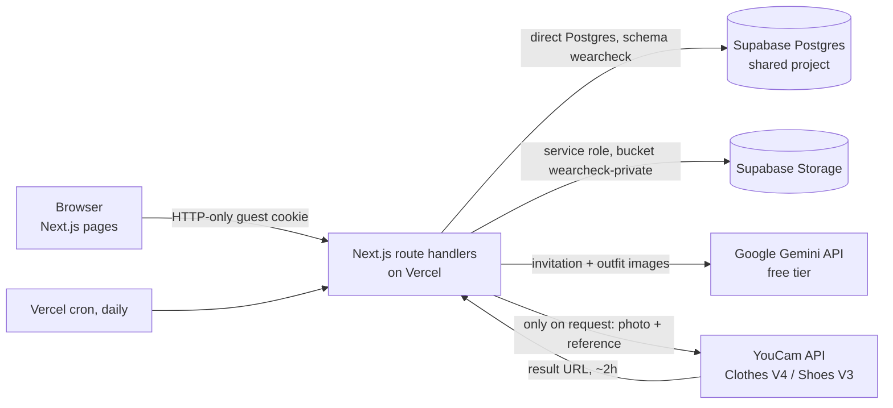

# WearCheck

**Check the outfit you already own against the invitation. Keep it, or preview one justified change.**

WearCheck reads an invitation (or details you type), asks you to confirm the event's requirements, looks at one photo of your outfit, and explains — requirement by requirement — whether anything conflicts. If nothing does, *"Keep your outfit"* is the result. If one item is the problem, you can choose a single alternative and YouCam's virtual try-on renders it onto your own photo so you can compare before deciding. Either way you can download a decision card.

It is not a styling chatbot, an attractiveness score, an outfit generator or a shop.

- **Live app:** https://wearcheck.vercel.app
- **Repository:** https://github.com/TheWeirdDee/wearcheck — implementation on branch `feat/wearcheck-implementation` (not merged to `main`)
- **Product spec:** [`WearCheck_Full_PRD_v1.md`](WearCheck_Full_PRD_v1.md)

---

## Status at a glance

What has and hasn't been demonstrated, kept deliberately separate. "Implemented" means the code exists and is covered by type checks and unit tests; only the other two columns are evidence that it works.

| Capability | Implemented | Verified locally | Verified on the live URL |
|---|---|---|---|
| Public pages, theme (light/dark/system), mobile menu, accessibility scan | ✓ | ✓ | ✓ (Playwright, desktop + mobile) |
| Horizontal scroll story (pinned GSAP, reverse, resize, reduced-motion fallback) | ✓ | ✓ | ✓ |
| Guest session, ownership checks, cross-browser denial, CSRF origin check | ✓ | ✓ | ✓ |
| Manual event entry → requirements review → confirm (with revisions) | ✓ | ✓ | ✓ |
| Invitation image → **real Gemini** extraction with exact quotes | ✓ | ✓ | ✓ (sample invitation fixture) |
| Outfit photo → **real Gemini** observation → rule-based assessment → keep → decision card PNG | ✓ | ✓ on a CC0 editorial photo, for UI verification only | ✗ not yet run on the live URL |
| Delete a check (database rows + stored files), and access revoked afterwards | ✓ | ✓ | ✓ (e2e) |
| Scheduled retention cleanup endpoint (secret-protected) | ✓ | ✓ | ✓ (401 without the secret, 200 with it) |
| **YouCam Clothes V4** render | ✓ | ✗ **not run** | ✗ |
| **YouCam Shoes V3** render | ✓ | ✗ **not run** | ✗ |
| Render refresh recovery, duplicate-submit protection, stale-revision handling | ✓ | Unit-level only | ✗ |

**The YouCam renders have not been run.** They need a full-length photo of a consenting adult, and none has been provided. Running them on someone else's photo, or on editorial stock photography, would misrepresent consent and blur evidence, so the gap stays open. See [Remaining manual actions](#remaining-manual-actions).

---

## Architecture



### Who decides what

| Component | Responsibility | Never does |
|---|---|---|
| **Gemini** (`lib/ai/gemini.ts`) | Transcribes invitation text and extracts candidate requirements; describes visible garments, colours, footwear and visibility. Output is schema-validated (Zod) and treated as observations. | Decide the verdict; follow instructions found in images; claim certainty about formality, religious or cultural dress, colour in poor light, or approval |
| **Rules engine** (`lib/rules.ts`) | Deterministic assessment against the *confirmed* requirements (PRD §8.4): conflicts, recommendations, insufficient information, clarifying questions. An invitation rule counts as "From invitation" only if its quoted text appears in the transcription. | Invent rules; treat missing feet as approval |
| **YouCam** (`lib/youcam/client.ts`, `lib/jobs.ts`) | Renders one chosen reference item onto the user's photo — Clothes V4 (`cloth-v4`) or Shoes V3 (`shoes-transfer`). | Run without an explicit user request; retry automatically after a failure |

### Routes

Pages: `/` · `/demo` · `/help` · `/privacy` · `/looks` (this browser's checks) · `/check/new` · `/check/[id]/{invitation,requirements,outfit,assessment,options,preview,decision}`

API (all state changes require a same-origin request and the owner's cookie):

| Route | Purpose |
|---|---|
| `POST /api/checks` | Create a guest check (optionally from an example) |
| `GET/DELETE /api/checks/[id]` | Read or delete a check |
| `POST /api/checks/[id]/invitation` | Upload invitation → Gemini extraction |
| `PUT /api/checks/[id]/event` | Manual event details |
| `PUT /api/checks/[id]/requirements` | Confirm requirements (new revision; supersedes assessments) |
| `PUT /api/checks/[id]/outfit` | Upload outfit photo with consent |
| `POST /api/checks/[id]/observe` · `/assessment` | Gemini observation · rule-based assessment |
| `POST /api/checks/[id]/reference` | Upload your own item to try |
| `POST /api/checks/[id]/decision` | Keep or change |
| `GET /api/checks/[id]/decision-card` | 1080×1350 PNG (`?download=1`) |
| `POST /api/render-jobs` · `GET /api/render-jobs/[id]` | Submit and poll a YouCam job (idempotent, leased) |
| `GET /api/media/[id]` | Owner-only image (`?size=thumb`, `?download=1`) |
| `DELETE /api/session/checks` | Delete every check in this browser |
| `GET /api/cron/cleanup` | Retention cleanup and job reconciliation (Bearer `CRON_SECRET`) |

---

## Setup

Requires Node 20.9+.

```bash
npm install
cp .env.example .env.local   # then fill in values — never commit this file
npm run dev
```

### Environment variables

Names only; values live in `.env.local` locally and in the Vercel project settings in production.

| Name | Purpose |
|---|---|
| `YOUCAM_API_KEY` | YouCam server key (Bearer) |
| `YOUCAM_API_BASE` | `https://yce-api-01.makeupar.com` |
| `GEMINI_API_KEY` | Google AI Studio key (free tier) |
| `GEMINI_MODEL` | `gemini-3.5-flash` (verified on the free tier; `gemini-2.5-flash` is closed to new keys) |
| `SUPABASE_URL` · `SUPABASE_SERVICE_ROLE_KEY` | Storage access (server only) |
| `SUPABASE_DB_URL` | Transaction-pooler connection string (port 6543) for the `wearcheck` schema |
| `SUPABASE_STORAGE_BUCKET` | `wearcheck-private` |
| `SESSION_SECRET` | HMAC key for guest cookies |
| `APP_ORIGIN` | Canonical origin, e.g. `https://wearcheck.vercel.app` |
| `CRON_SECRET` | Protects the cleanup endpoint |
| `RENDER_LIMIT_PER_SESSION` · `RENDER_LIMIT_GLOBAL_PER_DAY` | Paid-render caps (defaults 4 and 60) |

`node scripts/gemini-verify.mjs` lists the models your key can call and makes one tiny image request.

### Database and storage (shared Supabase project)

WearCheck shares a Supabase project with another application (AfterSend). It is isolated as follows:

- A dedicated **`wearcheck` schema**, reached only by the server over a direct Postgres connection. Supabase's API exposure settings were not changed; `anon` and `authenticated` have no usage on the schema, and RLS is enabled with no policies as defence in depth.
- A separate private bucket, **`wearcheck-private`**, created by the app on first use; objects live under `checks/<id>/…`.
- Migrations are additive and versioned (`db/migrations`). The runner refuses `drop`, `truncate`, `delete from`, role or default-privilege changes, extensions, and any reference to another schema.

```bash
npm run db:inspect     # read-only inventory → private-ops/
npm run db:plan        # print exact SQL and run the scope check
npm run db:migrate     # apply, one transaction per file
node scripts/db-fingerprint.mjs <label>            # structural fingerprint of everything that is NOT WearCheck
node scripts/db-fingerprint.mjs --compare a b      # prove nothing else changed
```

The AfterSend check before and after the migration, and again after deployment, was a structural fingerprint of its schemas, columns, constraints, indexes, RLS flags, policies, grants, default ACLs, functions, triggers, API roles, extensions and bucket configuration. All three comparisons were identical. AfterSend's `/api/health` also reported its database OK, and its public pages returned 200, each time. No AfterSend rows were read.

## Build, test, deploy

```bash
npm run typecheck && npm run lint && npm test && npm run build
npx playwright install chromium
E2E_BASE_URL=http://localhost:3001 npx playwright test                       # public + guest workflow
E2E_LIVE=1 E2E_INVITATION=tests/fixtures/sample-invitation.png npx playwright test -g invitation   # real Gemini
E2E_LIVE=1 E2E_PHOTO=<permissioned full-body photo> npx playwright test -g "live pipeline"         # real Gemini, no render
node scripts/screenshots.mjs <baseUrl> <outDir> <light|dark>                 # 320/390/768/1024/1440, overflow + console checks
node scripts/youcam-proof.mjs cloth-v4 <photo> <reference> full_body        # records task id, latency, credits used
node scripts/youcam-proof.mjs shoes-transfer <photo> <reference>
```

Deployment: Vercel project `wearcheck` (framework pinned to Next.js in `vercel.json`), with production env vars set in the dashboard and a daily cron at 04:17 UTC (the Hobby plan allows daily cron only). Run `vercel deploy --prod`.

---

## Privacy, retention and failure behaviour

- **No accounts.** A random token in an HTTP-only cookie (`__Host-wc_guest` over HTTPS) identifies the browser. The database stores only its SHA-256 hash.
- **Ownership on every request:** a check ID alone opens nothing.
- **Retention:** a check expires 24 hours after it starts. Cleanup runs daily, and opportunistically as people use the app, deleting files and rows, normally within a day of expiry. A small usage ledger (provider, feature, task reference, status, timing; no images or text) is kept for budget control.
- **Deletion:** access is blocked first, then storage objects are removed, then rows. Copies held by Google or YouCam follow their own policies, and WearCheck does not claim to delete them.
- **Gemini free tier:** Google's unpaid terms allow submitted content to be used to improve its services. The privacy page says so. The verified limit is 5 requests per minute; a 429 shows a clear message and offers manual entry. Nothing switches to a paid model.
- **YouCam spend:** jobs are idempotent with a single active job per check, per-session and global daily caps apply, and nothing is retried automatically. "Cancel waiting" stops polling only; it is not claimed to stop provider billing.
- **SSRF:** provider downloads are limited to HTTPS on allow-listed YouCam/AWS hosts, with no redirects and with size caps.
- **Logs** redact URLs, tokens and connection strings, and never record image or invitation contents.

## Assets and licences

- **Editorial photographs** (`public/editorial/`) are CC0 Unsplash originals mirrored on Wikimedia Commons, cropped and colour-graded by `scripts/build-editorial.mjs`. Source, photographer, licence, hash and every modification are recorded in `public/editorial/LICENSES.json`. They illustrate scenarios only: they are labelled on the page, are never presented as a WearCheck or YouCam result, and are not provider-test evidence. The cropped-feet and low-light guide images are edits of one photo and are labelled as such.
- **Reference items** (`public/reference/`) are licence-documented (CC0 from the Met; CC BY 2.0; CC BY-SA 4.0) and labelled "Visual reference — not a live shopping listing". Each was checked against YouCam's documented input rules (size, a single front-facing garment, product coverage of at least 25% of the image height, worn shoes at least 800 px). A dress photographed together with a separate bolero was **disabled** as a composite. The remaining items meet the documented rules, but whether they render well is unproven until a real render runs.
- **Fonts:** Inter and Inter Tight, SIL OFL 1.1.

## Known limitations

- No real YouCam render yet (see above), so the landing page has no recorded original/preview comparison. That section appears only once `lib/showcase.ts` holds a real, publicly permitted output.
- The editorial set comes from mixed lifestyle shoots rather than a controlled studio session. A shared crop and colour grade bring it closer together, but a commissioned or licensed studio set would be better. Gemini image generation, which could have produced one, is not available on this free tier (429 on every image model).
- The reference catalogue is small and historical (museum garments on dress forms).
- PDF invitations are not supported; HEIC works only where the browser can decode it.
- The COS website blocks automated browsers, so its layout and motion could not be inspected. The design is WearCheck's own editorial direction and was not copied from COS.

## Remaining manual actions

1. Provide 2–3 full-length photos of one consenting adult, feet visible, at least 1024 px (narrow heels; a white or ivory outfit; smart casual) in `private-assets/people/`. Confirm in writing that the person is an adult and consents, and say separately whether public display is allowed.
2. Then run both `scripts/youcam-proof.mjs` commands, the `live pipeline` e2e test locally and against the live URL, and a render's refresh-recovery path.
3. Only with public-use permission: add the output to `lib/showcase.ts`, record the demo video, and use it in submission screenshots.
