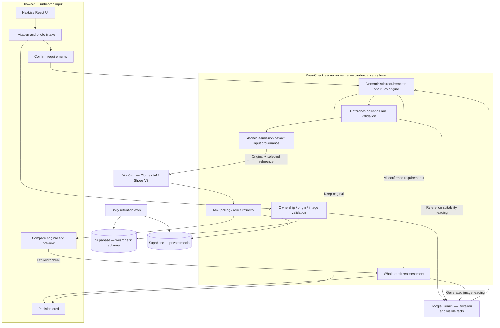

# WearCheck

**Check the outfit you already own against the invitation. Keep it, or preview one justified change.**

WearCheck helps a guest prepare for a wedding, work event or another occasion. Confirm what the host actually asked for, check a photo of the outfit you plan to wear, and see which requirements appear met, conflict or cannot be assessed. Keeping your outfit is a complete result.

For example, “Please avoid white or ivory” applies to a visible white underlayer as well as the main shirt. A blue-shirt preview is useful only if the whole resulting outfit is checked again. WearCheck combines that requirement trail with YouCam virtual try-on so a guest can consider a specific correction before wearing or considering buying an item.

- **[Open WearCheck](https://wearcheck.vercel.app)** · **[Recorded real-output comparisons](https://wearcheck.vercel.app/demo)**
- **[Source on main](https://github.com/TheWeirdDee/wearcheck/tree/main)** · [MIT source licence](LICENSE) · [Product specification](WearCheck_Full_PRD_v1.md)
- References are licensed visual examples, **not live shopping listings**. No stock, prices, sizes, checkout or retailer partnership is claimed. [Future retail design](docs/product-direction.md) is a proposal, not a shipped integration.

## The product workflow

1. **Add the invitation or type the details.** Gemini extracts candidate requirements with source quotations; typed details are labelled as entered by you.
2. **Confirm or edit the requirements.** The confirmed revision, not an unreviewed model interpretation, drives the assessment.
3. **Add an outfit photo with consent.** Visibility matters: cropped clothes, unseen shoes and uncertain colours cannot silently become a pass.
4. **Read the requirement-by-requirement assessment.** Compatible, conflict, insufficient information and no stated requirements have distinct outcomes.
5. **Keep the original or choose an eligible alternative.** Browse the small licensed set, or upload a clear product photo of an item you own or are considering. Each option explains why it is offered.
6. **Explicitly request a YouCam preview.** Compare the original and generated image using full-frame toggles, a slider and changed-area zoom.
7. **Recheck the whole generated outfit.** Gemini re-reads the result and WearCheck evaluates **all confirmed requirements**, including other layers and footwear. Saving a considered change requires a completed recheck. A guest can save an unresolved choice, but its status remains unresolved.
8. **Download a decision card.** Keep or change, the card preserves the finding, evidence source and reassessment status.

A preview is not proof of fit, comfort, exact visual fidelity or event approval. Reassessment is an AI reading plus deterministic evaluation, not a guarantee that every garment was detected.

## Why YouCam is essential

Advice alone cannot show the selected item on the guest's original photo. YouCam supplies that concrete visual comparison; WearCheck supplies the reason for the change, eligible reference and subsequent requirement check.

| Engine | Actual use | Task endpoint |
|---|---|---|
| Clothes V4 | A reference-guided garment preview; category bound by the server | `POST /s2s/v2.0/task/cloth-v4` |
| Shoes V3 | A reference-guided footwear preview when the photo supports it | `POST /s2s/v2.0/task/shoes-transfer` |

The [server adapter](lib/youcam/client.ts) registers the original and reference separately with `POST /s2s/v2.0/file`, uploads their bytes using provider-issued instructions, and submits the returned `src_file_id` and `ref_file_id`. Clothes requests also specify `garment_category`; shoes requests use the two file IDs without invented gender/style fields. The public API host is `https://yce-api-01.makeupar.com`.

[Job orchestration](lib/jobs.ts) persists the exact source/reference SHA-256 values, catalogue or uploaded asset identity, provider file IDs, feature and category **before task creation**. It polls `GET /s2s/v2.0/task/{feature}/{task_id}`, validates and downloads successful output, and copies it into private storage. The browser uses owner-checked media routes, not provider result URLs. Controlled adapter tests assert exact uploaded bytes and file-ID correspondence; real hosted jobs retain their actual provenance.

### Verified final-runtime provider journeys

These are the **2 November 2026** release checks, not an aggregate of older experiments:

| Operation | Verified input and outcome | Application generation time |
|---|---|---|
| Clothes V4, first reference | Same original/check; `top-blue-shirt`. Long-sleeved blue output; recheck reported the confirmed No-red requirement appears met | 39 s |
| Clothes V4, second reference | Same original/check; `top-green-seersucker`. Different reference hash/file ID and visibly different short-sleeved striped output; No-red recheck appears met | 30 s |
| Shoes V3, uploaded reference | Validated `pump-nude-pointed.jpg`; normalised uploaded-asset hash matched the submitted reference. Black shoes became nude pointed footwear, but heel characteristics could not be established; Gemini read flats. **Recheck and downloaded card remained unresolved** | 28 s |

**Two hosted journeys passed, creating three actual tasks.** Balance readings went from **972 to 966: six units used**, with no task retry. The clothing journey verified selection/rejection persistence, exclusion after each attempt and an honest exhausted catalogue. The shoe journey verified the uploaded reference, refresh, comparison, recheck, opened 1080×1350 card, ownership isolation and deletion. Durations are observed application generation times, not performance guarantees or full-journey latencies. Other clothing layers changed; the striped output's hue was not an exact match.

The later runs used a permissioned private testing photo. Their original/generated photographs, full task IDs, signed URLs and raw operational reports are **not published in this repository**. Retained private evidence includes `release-final-providers.json`, `release-provider-proof.json` and the reviewed screenshots; these are maintainer evidence names, not judge-accessible links.

Publicly inspectable **historical** examples use a licensed CC0 source: [original](public/showcase/brick-wall-original.jpg), [real Clothes V4 output](public/showcase/brick-wall-preview-shirt.jpg), [real Shoes V3 output](public/showcase/brick-wall-preview-loafers.jpg). They were recorded on **1 November**, not in the later three-task run. The public shirt output retains white underneath and does not resolve a white exclusion. [Recorded provenance](lib/showcase.ts) and [asset permissions](docs/public-assets.md) describe their scope; no model release is on record.

## Reference selection and uploaded items

The [catalogue](lib/catalogue.ts) has **8 records, 7 enabled for fresh selection**:

| Category | Enabled references |
|---|---|
| Upper body | Blue long-sleeved button-down; green-and-white short-sleeved seersucker shirt |
| Full body | Black silk dress |
| Shoes | Black tassel loafer; tan cap-toe oxford; nude pointed court heels; black low block-heel court shoe |
| Outer layer | No curated reference; a suitable upload may be used if the photo and requirements support the operation |

The worn-on-foot black wedge record is disabled for fresh selections and retained for attribution/history. Available choices can be fewer than the inventory: eligibility depends on the confirmed rules, photo support, observed outfit and attempt history.

- Known colour, garment, coverage, footwear and applicable formality constraints filter **before ranking**. Green/white stripes are excluded under “No white”. Unknown suitability is withheld, including optional browsing; vague codes cannot be certified by this small set.
- Exact source/file duplicates and perceptually similar images are withheld. Current-look similarity uses conservative named attributes, **not visual garment-identity recognition**.
- References already attempted on the current assessment are excluded. Browser-persisted selection/rejection survives refresh; “Try another item” retains the category/finding. One-item and empty states explain the limit instead of repeating an item or violating a rule.
- [Uploaded-reference validation](lib/reference-validation.ts) reads category, product-photo usability, all visible colours, style and relevant suitability before admission. Wrong-category, conflicting or uncertain inputs are refused. Stored validation is bound to the current requirements revision and checked server-side before a paid request. This does not certify the eventual generated outfit.

## Release and verification

**Status: shipped repairs with a qualified AI verification gate.** Do not interpret the table below as a completely green fresh AI rerun.

- Application release merged into **`main` at `9dc51ae69c9ee2a1716c11ce4256014a724fcced`**; the former implementation branch was deleted. Subsequent README-only changes do not change application behaviour.
- Production `https://wearcheck.vercel.app` independently returned **`X-WearCheck-Commit: 7dcdb8010bc606fc97eb74d6a6f76072972a9bd6`** during this README audit.
- Recorded deployment ID: `dpl_3FwJ4wryaMQmDBRGXGWrv48Swcqk`. Its deployment-specific hostname redirects unauthenticated visitors to Vercel login; judges should use the public production URL above. Application files at the tested runtime and merged main release are identical; their file difference is README only. This documentation update does not deploy a new runtime.

| Gate | Actual evidence and limits |
|---|---|
| Typecheck, lint, production build | Passed after final eligibility/copy corrections; lint zero warnings. Final Vercel build also passed. Retained release report; not rerun for this README-only edit |
| Unit tests | **113 passed**; **15 opt-in integration cases skipped** in unit mode. Independently rerun while preparing the judge PDF, with machine-readable results and no provider calls |
| Controlled integration | **15 passed**, using isolated real DB fixtures with mocked providers/storage. Includes concurrent admission, lost task response/crash/5xx ambiguity, exact bytes/file IDs, quotas, revision isolation, deletion failure and orphan compensation |
| Final-runtime hosted non-provider suite | **42 passed, 2 device-specific skips**, desktop/mobile on `7dcdb80`. Public pages, accessibility scans, comparison, manual workflow, origin/ownership and deletion |
| Final-runtime real YouCam | **2 passing journeys / 3 actual tasks**, on `7dcdb80`; outcomes and six-unit usage above. Paid live races were not used |
| Earlier hosted AI assessments | On `ea9947b`: **4 passed**; uploaded-reference admission separately **1 passed** after correcting an unstable test locator. These are earlier-source evidence, not a fresh five-case pass on the final runtime |
| Final five-case Gemini rerun | **Incomplete, not green.** Reference request hit `ECONNRESET`; cropped-photo case showed `VISION_BUSY`. Logs recorded primary quota exhaustion and two fallback 503 responses. Stopped after two failures; remaining cases uncompleted |
| Real hosted quota/expiry fixture | On `ea9947b`: POST 429 / `RATE_LIMITED`, `Retry-After: 14`, reset metadata, existing-check 200, countdown recovery and expired-check 404. Only owned fixture rows manipulated; no provider call |
| Local browser issues | Initial run: **40 passed, 2 skipped, 2 failed** from inherited state in supposed other-owner contexts. Explicit empty contexts fixed the tests; desktop/mobile isolation reruns **2 passed**. Earlier local creation stalls have no proven root cause |
| Privacy/deletion | Hosted ownership and media revocation asserted. Final cleanup deleted **23 remaining task-owned checks**, verified no check rows for those two guests and empty asset prefixes; not an audit of unrelated production data |
| Licence metadata | **17 checked, zero mismatches**, source-specific Commons metadata audit |

The Gemini failure logs named configured primary `gemini-3.5-flash` with quota metric model `gemini-3.6-flash`, limit 20, and fallback `gemini-3.1-flash-lite` returning 503. This records the observed failure, not a promise about current account limits or present service health. No newer successful five-case rerun is recorded. A fresh pass after service recovery remains outstanding.

Public evidence: [unit regressions](tests/unit), [controlled integration tests](tests/integration), [hosted journey assertions](tests/e2e), [initial repair audit](docs/release-audit-2026-11-02.md) and the public output files above. The audit is historical and contains gates that were pending when written; this README states the later results. Raw reports and consent-sensitive images remain private. A separate 12-page judge PDF was generated locally for manual Devpost attachment; it has no public download URL here.

## Architecture



[Gemini](lib/ai/gemini.ts) extracts/observes; [WearCheck rules](lib/rules.ts) evaluate confirmed requirements; [YouCam](lib/youcam/client.ts) generates. Zod validates model output; image text is treated as untrusted data. Schema validation cannot make visual recognition infallible.

### Routes

Pages: `/`, `/demo`, `/help`, `/privacy`, `/looks`, `/check/new`, and `/check/[id]/{invitation,requirements,outfit,assessment,options,preview,decision}`.

Check/media/job routes require the owning session; state changes require an allowed origin. Cleanup is separately secret-protected.

| API route | Purpose |
|---|---|
| `POST /api/checks` | Idempotent guest check creation; `GET /api/checks` correctly returns 405 |
| `GET/DELETE /api/checks/[id]` | Read/delete an owned check |
| `POST /api/checks/[id]/invitation` | Invitation image extraction |
| `PUT /api/checks/[id]/event` | Typed event details |
| `PUT /api/checks/[id]/requirements` | Confirm a revision; supersede stale assessments |
| `PUT /api/checks/[id]/outfit` | Outfit upload with consent |
| `POST /api/checks/[id]/observe` and `/api/checks/[id]/assessment` | Vision observation and rule evaluation |
| `POST /api/checks/[id]/reference` | Validate/store an uploaded reference |
| `POST /api/checks/[id]/decision` | Keep original or save considered change |
| `GET /api/checks/[id]/decision-card` | 1080×1350 PNG; `?download=1` |
| `POST /api/render-jobs`; `GET /api/render-jobs/[id]` | Admit and advance/resume a provider job |
| `POST /api/render-jobs/[id]/recheck` | Re-read generated outfit and evaluate every confirmed requirement |
| `GET /api/media/[id]` | Owner-checked image; `?size=thumb` / `?download=1` |
| `DELETE /api/session/checks` | Delete this browser session's checks |
| `GET /api/cron/cleanup` | Reconcile jobs and clean expired data; Bearer `CRON_SECRET` |

## Setup

Node **20.9+**, npm, a configured Supabase project, a Gemini key and a YouCam key/credits are required. The repository pins its installed Next.js/React versions through the lockfile.

```bash
npm ci
cp .env.example .env.local
# Fill server-only values; set APP_ORIGIN=http://localhost:3000.
npm run db:plan
# Inspect the pending SQL and use a dedicated test database first.
npm run db:migrate
npm run dev
```

PowerShell: use `Copy-Item .env.example .env.local` instead of `cp`. Never commit `.env.local`. See [environment template](.env.example) and [validated configuration](lib/env.ts).

### Environment variables

| Name | Purpose / source default |
|---|---|
| `YOUCAM_API_KEY` | Server-only YouCam Bearer key |
| `YOUCAM_API_BASE` | `https://yce-api-01.makeupar.com` |
| `GEMINI_API_KEY` | Server-only Google key; quota/billing depend on the account |
| `GEMINI_MODEL` | Primary; template/default `gemini-3.5-flash` |
| `GEMINI_FALLBACK_MODEL` | Optional; template `gemini-3.1-flash-lite`; best-effort fallback after quota or persistent busy/network errors |
| `SUPABASE_URL`, `SUPABASE_SERVICE_ROLE_KEY` | Private Storage access, server only |
| `SUPABASE_DB_URL` | Postgres connection; transaction pooler supported with prepared statements disabled |
| `SUPABASE_STORAGE_BUCKET` | Dedicated private bucket; default `wearcheck-private` |
| `SESSION_SECRET` | Guest-cookie HMAC secret, at least 32 characters |
| `APP_ORIGIN` | Canonical allowed origin; local HTTP or production HTTPS |
| `CRON_SECRET` | Cleanup endpoint secret, at least 16 characters |
| `RENDER_LIMIT_PER_SESSION` | Paid-render cap; default 4 |
| `RENDER_LIMIT_GLOBAL_PER_DAY` | Global rolling-24-hour paid-render cap; default 60 |
| `WEARCHECK_COMMIT` | Build-time deployment identity, exposed as `X-WearCheck-Commit` |
| `WEARCHECK_DB_TRACE` | Optional diagnostic: `1` logs statement prefixes, not query arguments; leave unset normally |

Vercel supplies its own `VERCEL_*` origin variables. No provider key belongs in browser code or a `NEXT_PUBLIC_*` variable. The Gemini adapter shares a 48-second budget across attempts, retries busy/network failures at most once per model within that budget, and records the serving model. Fallback is not guaranteed extra capacity and does not automatically change account billing configuration. Manual invitation entry avoids extraction but does not replace the need for vision in outfit/reference/recheck operations.

### Database and storage scope

WearCheck uses server-side SQL in the dedicated `wearcheck` schema and a private bucket with `checks/<id>/<kind>/...` keys. Migrations are additive and versioned under [db/migrations](db/migrations); the [migration runner](scripts/migrate.mjs) checks for destructive or out-of-scope statements. SQL queries name the schema explicitly. RLS is enabled without browser-facing policies; private storage uses server-only credentials. Do not expose the schema or bucket publicly.

```bash
npm run db:inspect
npm run db:plan
npm run db:migrate
node scripts/db-fingerprint.mjs before
node scripts/db-fingerprint.mjs after
node scripts/db-fingerprint.mjs --compare before after
```

The final repair applied WearCheck migrations 0002–0004. Shared-project structural snapshots agreed in **11/13 sections**: Storage gained a platform versioning function/trigger, with `unlock-object-versioning` recorded in Storage migrations. No unrelated schema/policy was edited or reverted by this repair. The later final snapshot matched the post-change snapshot in all 13 sections. This is structural evidence, not an audit of unrelated users' rows.

## Build, test, deploy

```bash
npm run typecheck
npm run lint -- --max-warnings=0
npm test -- --maxWorkers=1
npm run build
npx playwright install chromium
# In another terminal: npm run dev
E2E_BASE_URL=http://localhost:3000 npx playwright test --grep-invert '@live'
# Isolated real DB fixtures, mocked provider/storage calls:
INTEGRATION=1 npx vitest run tests/integration --maxWorkers=1
```

The environment-prefix examples above/below use POSIX shell syntax. In PowerShell, set each variable first with `$env:NAME='value'`, then run the command. Clear opt-in flags afterward with `Remove-Item Env:NAME`.

Real AI checks need an authorised full-length photo and consume reading quota:

```bash
E2E_BASE_URL=https://wearcheck.vercel.app E2E_LIVE=1 E2E_PHOTO=/path/to/permissioned-photo.jpg npx playwright test --project desktop --grep 'live assessments'
```

Paid generation is a **separate explicit opt-in**. The following selects the two-shirt and uploaded-shoe journeys: **three tasks / six expected units**, with no automatic paid task retry. Do not run without photo rights, quota and a deliberate budget.

```bash
E2E_BASE_URL=https://wearcheck.vercel.app E2E_LIVE=1 E2E_RENDER=1 E2E_RELEASE_PAIR=1 E2E_PHOTO=/path/to/permissioned-photo.jpg npx playwright test --project desktop --grep 'two distinct clothing|shoes .Shoes V3'
```

`E2E_STORAGE_STATE` can retain one private guest browser between journeys; `E2E_JSON_OUTPUT` saves a machine-readable report. Both outputs must stay private. Tests fail on missing preconditions; the paid journeys test mobile comparison layouts inside desktop runs to bound spend. Read-only operational checks: [credit balance](scripts/youcam-balance.mjs) and [asset licence audit](scripts/audit-asset-licences.mjs); their evidence outputs stay private. The [reference fingerprint script](scripts/reference-fingerprints.mjs) writes a tracked manifest and is a separate maintenance task, not a read-only verification command.

Deployment uses the existing Vercel project `wearcheck`, production environment values and [vercel.json](vercel.json). For an explicitly authorised deployment, set `WEARCHECK_COMMIT` to the full committed SHA at build time:

```bash
vercel deploy --prod --build-env WEARCHECK_COMMIT="$(git rev-parse HEAD)"
```

Verify the live response header afterward. The cron schedule is `17 4 * * *` (04:17 UTC daily). This README-only change does not deploy or rerun paid tests.

## Privacy, rate limits and failure handling

- **Ownership:** signed HTTP-only guest cookie (`__Host-wc_guest` over HTTPS); only the token hash is stored in the session table. Owner checks protect check/media/job access. Allowed-origin checks protect state changes. Uploads receive size/type/decode validation and metadata stripping.
- **Retention:** access locks 24 hours after check creation. Daily cleanup, plus small opportunistic batches on new checks, normally removes files/rows within the following day. Cleanup can defer a check with a still-active job younger than an hour; storage failures retain retryable rows. This is a schedule, not an exact physical-deletion deadline. A small provider usage ledger remains for budget/accounting; it contains no images or invitation text. Provider-held copies follow provider policies; app deletion does not claim to erase them.
- **Deletion:** revoke access first, remove recorded objects and sweep the check's own prefixes, then remove rows. Compensating removal covers asset-save failure/racing deletion. Controlled storage failure tests passed; scoped hosted cleanup checked empty prefixes. The global retention cron was not forced against unrelated production records in this repair phase.
- **Creation quota:** atomic/idempotent per guest/request UUID, 20 new checks/hour per session. A separate 20/hour network backstop applies only to starting fresh browser sessions. Existing sessions on a shared network do not share their check allowance.
- **Other app limits:** 30 uploads/hour and 20 vision readings/hour per guest; 200 vision readings/rolling day globally; 6 fresh render admissions/hour per guest. Paid caps are separate. These application limits do not guarantee provider capacity. Sliding-window 429s expose actual reset/Retry-After metadata; the UI counts down and offers existing checks. Request replays do not consume another creation/render admission.
- **Paid admission:** transactional locks enforce one active render per check, current photo/revision and session/global caps. Identical requests resume the same job. Controlled concurrency fixtures passed; no paid live race was performed.
- **Ambiguous submission:** durable pre-submit marker; lost response/crash/provider 5xx can mean “unknown outcome / possible charge”. No silent resubmission. An explicit retry may incur another charge. Stopping browser polling does not promise provider cancellation or refunded billing.
- **Provider/storage boundaries:** HTTPS host allowlist, no redirects, output size/decode checks and timeouts; Storage fetches have a 20-second deadline. Sanitised app logs and first-party CSP remain in place. CSP allows Next bootstrap inline scripts, so this is not a claim of a strict nonce-only policy.

See the [live privacy notice](https://wearcheck.vercel.app/privacy), [privacy implementation](lib/privacy.ts), [rate limits](lib/rate-limit.ts), [admission](lib/jobs.ts), [controlled failure tests](tests/integration) and [security regressions](tests/unit/security.test.ts). Account/provider data-processing terms and availability must be checked for the intended use; neither content confidentiality at a third-party provider nor model accuracy is guaranteed here.

## Assets, evidence permissions and limitations

Source code is [MIT](LICENSE); individual images keep their own licences. [Editorial licences](public/editorial/LICENSES.json), [reference licences](public/reference/LICENSES.json) and [public permission notes](docs/public-assets.md) record authors, sources and modifications. The 17-record audit checked source-specific licence metadata; it does not establish model releases. Inter and Inter Tight use SIL OFL 1.1.

The public source photograph is Brooke Cagle's Unsplash image via Commons, documented as uploaded before 5 June 2017 under CC0. This is a specific source's licence, not a blanket statement that Unsplash is CC0. No model release is on record, and the person has not reviewed the AI previews. Private owner-photo consent is not treated as blanket permission for a repository, website or judge document.

Remaining limits:

- Small reference set and conservative suitability filters; some categories/codes have no eligible item. No visual garment-identity recognition or retail inventory.
- Gemini quota/capacity and variable observations; the fresh final five-case gate remains incomplete. No end-to-end availability or accuracy guarantee.
- Generated pose, hue, layers and footwear can differ from the reference. Whole-outfit reassessment can still miss a garment or leave a feature unresolved. The final court-heel result is explicitly unresolved.
- Automated accessibility/viewport checks are not a complete assistive-technology or usability study. No adoption, sales or impact metrics have been established.
- PDF invitations are unsupported; HEIC intake depends on browser decode support. A clear single-person full-length photo is needed for supported try-on operations.

## Previous video — outdated for the final release

The existing **180-second** local video was recorded against **`f1b68730e778740672f70141e304cf70d781bf09`**, before the final `7dcdb80` repairs. **It does not demonstrate the final release.** [Historical recording notes](docs/demo-script.md) describe that earlier runtime and contain behaviours superseded by the current implementation. It was not redone during the repair, judge-PDF or README phases.

The file and private scripts/footage remain local and excluded from deployment. No current public video URL is asserted. A refreshed recording and any public upload/submission are separate work; this README does not claim they have occurred.
